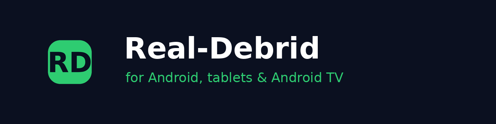
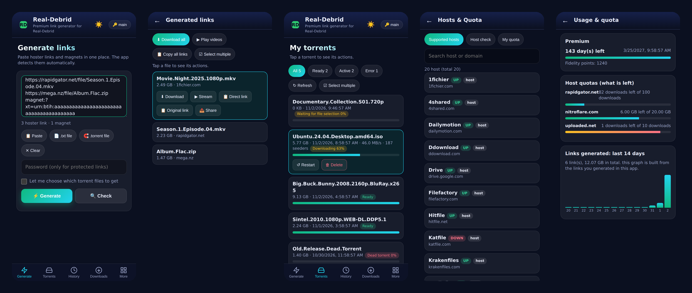
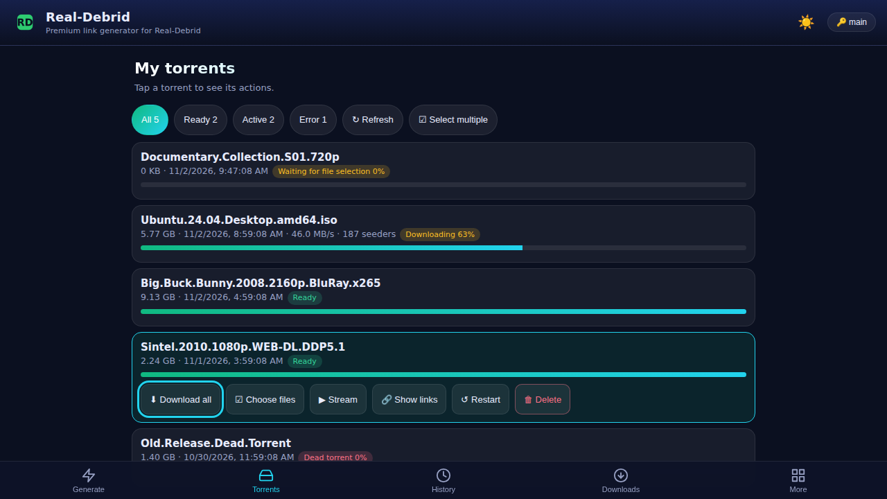
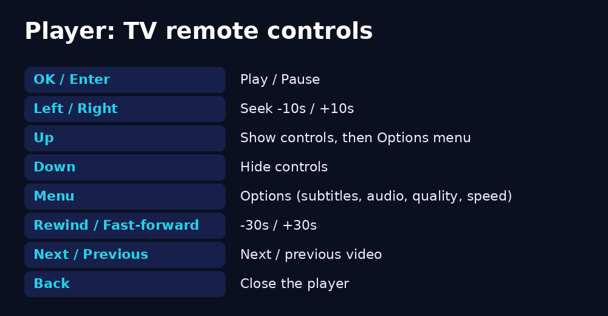
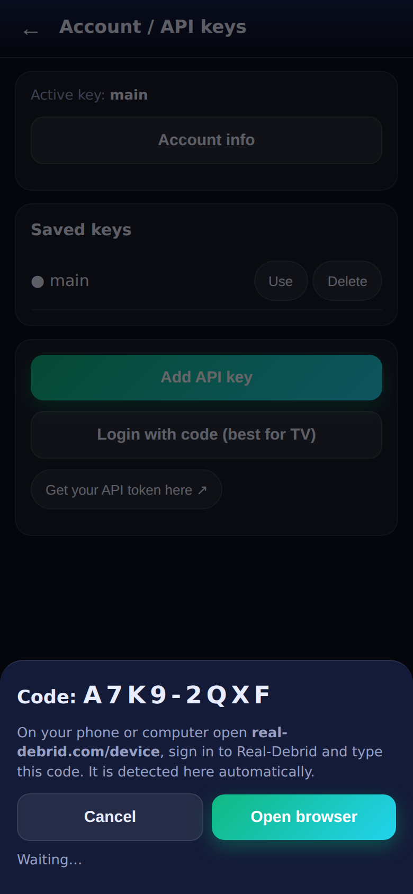
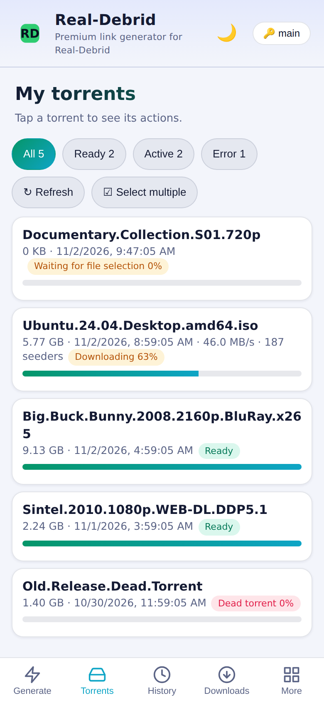
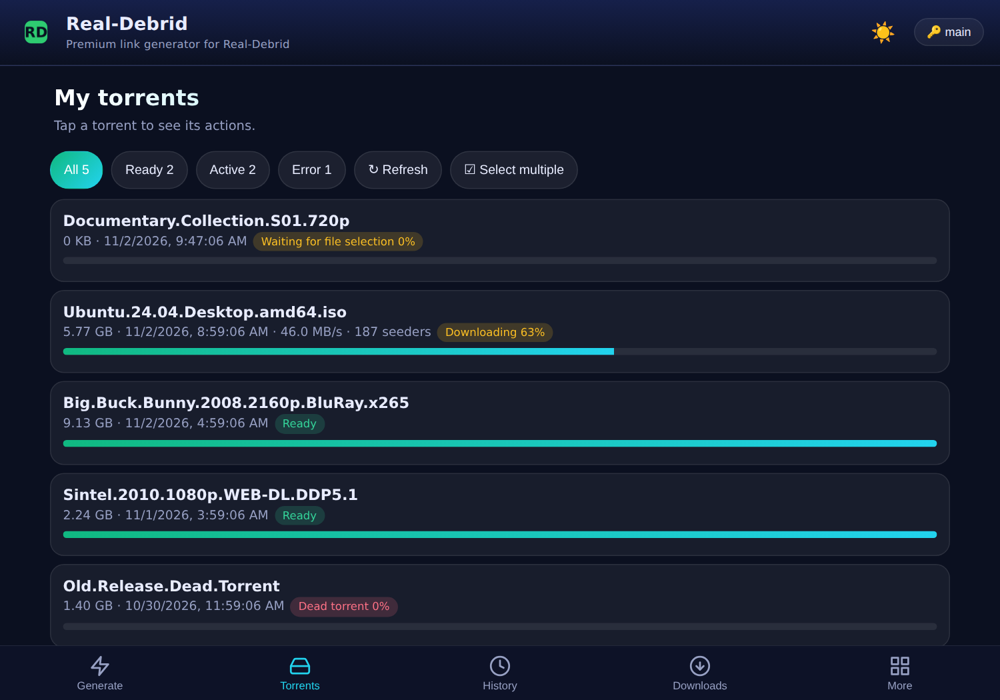

<p align="center"></p>

<h1 align="center">Real-Debrid for Android &amp; Android TV</h1>

<p align="center">
  <a href="../../releases/latest"></a>
  
  
  
</p>

An unofficial, free and open-source client for the [Real-Debrid](https://real-debrid.com) REST API. One APK runs on **phones, tablets, Chromebooks, Android TV, Google TV and Fire TV**. It is the Real-Debrid twin of the AllDebrid app: same screens, same features, same built-in player.

> Not affiliated with Real-Debrid. You need your own Real-Debrid premium account.

<p align="center"></p>

## Features

| | |
|---|---|
| **Links** | Unrestrict many hoster links at once, password-protected links, link checker, clipboard detection |
| **Torrents** | Magnet links, `.torrent` files, choose files before download, live progress / speed / seeders, filters, delete, add again |
| **Player** | Built-in ExoPlayer with FFmpeg codecs (HEVC, DTS, AC3, TrueHD...), subtitles (embedded or `.srt/.vtt/.ass`), audio tracks, speed, 4K/HDR, resume, pinch zoom, **Chromecast**, transcoded qualities |
| **Downloads** | Own download manager: pause / resume / stop, background service, retry with fresh link, saved in `Downloads/RealDebrid` |
| **Account** | Several API tokens, **login with code** (type a code on your phone, ideal for TV), account info, premium days |
| **Hosts &amp; quota** | Supported hosts with live status, host checker, limited-host quotas, 14-day usage graph |
| **History** | Local history (hoster links / torrents), Real-Debrid *Downloads* list, CSV export |
| **Extras** | App lock (biometric / PIN), light &amp; dark theme, in-app updates from GitHub Releases, opens `magnet:` links and `.torrent` files |

## Android TV / Google TV / Fire TV

The app appears in the TV launcher and is fully usable **with the remote only**: arrows move between buttons, **OK** presses, **Back** goes back. Typing a long token with a remote is painful, so use **More → Account → Login with code**: the TV shows a code, you enter it on `real-debrid.com/device` on your phone.

<p align="center"></p>

<p align="center"></p>

## Other screens

<p align="center">
   
   
  
</p>

> Pictures are rendered from the app's real interface with demo data (`tools/make_screenshots.py`). The video player is native Android and is not shown.

## Install

1. Open the [**Releases**](../../releases/latest) page and download `RealDebrid.apk`.
2. Open it and allow *Install unknown apps* once. On TV use a USB stick, *Downloader* or *Send Files to TV*.
3. If Google Play Protect says the app is not known, tap **More details → Install anyway**. Every app installed outside the Play Store shows this; the APK is signed with a permanent key, so updates install over the old version.
4. Open the app → **More → Account** → add your token from <https://real-debrid.com/apitoken> (never expires) or use **Login with code**.

## Build your own signed APK on GitHub (no PC needed)

1. Create a **public** repository and upload everything in this folder (include the `.github` folder).
2. Repository → **Settings → Secrets and variables → Actions → New repository secret**:
   - `KEYSTORE_BASE64` = base64 of your keystore (one line)
   - `KEYSTORE_PASSWORD` = its password
3. **Settings → Actions → General → Workflow permissions → Read and write**.
4. Push. After 3-6 minutes **Releases** contains `RealDebrid.apk` (signed), a SHA-256 file and release notes. Every later push makes a new release with a higher version, and the app offers it as an update.

Make your own keystore (keep it private, back it up):
```bash
keytool -genkeypair -keystore release.p12 -storetype PKCS12 -alias realdebrid -keyalg RSA -keysize 4096 -validity 36500
base64 -w0 release.p12      # paste into KEYSTORE_BASE64
```
The alias must stay `realdebrid` (or edit `app/build.gradle`).

## How it maps to the API

The UI keeps the AllDebrid data shapes; `app/src/main/assets/rd-api.js` translates every call to the Real-Debrid REST API v1.0:

| App function | Real-Debrid endpoint |
|---|---|
| Account | `GET /user` |
| Generate / unlock | `POST /unrestrict/link` |
| Check links | `POST /unrestrict/check` |
| Add magnet / `.torrent` | `POST /torrents/addMagnet`, `PUT /torrents/addTorrent` |
| Pick files | `POST /torrents/selectFiles/{id}` |
| Torrent list / status | `GET /torrents`, `GET /torrents/info/{id}` |
| Delete / restart | `DELETE /torrents/delete/{id}` / add the same hash again |
| Hosts / quota | `GET /hosts/status`, `GET /traffic` |
| Server history | `GET /downloads`, `DELETE /downloads/delete/{id}` |
| Streaming qualities | `GET /streaming/transcode/{id}` |
| Login with code | `/oauth/v2/device/code`, `/device/credentials`, `/token` |

Differences from AllDebrid: Real-Debrid needs files to be chosen *before* a torrent downloads, has no delayed links and no restart call, and its instant-availability check is no longer offered.

## Development

```bash
node tests/rd-api.test.js        # API layer against a fake Real-Debrid server
python tools/make_screenshots.py # regenerate the pictures
```
Android Studio: open the folder, build `app`. Needs AGP 8.7, Gradle 8.9, JDK 17, compileSdk 35, minSdk 26 (Android 8.0).

## License
MIT. The bundled FFmpeg decoders (NextLib) are GPL-3.0: respect that if you redistribute the APK.
